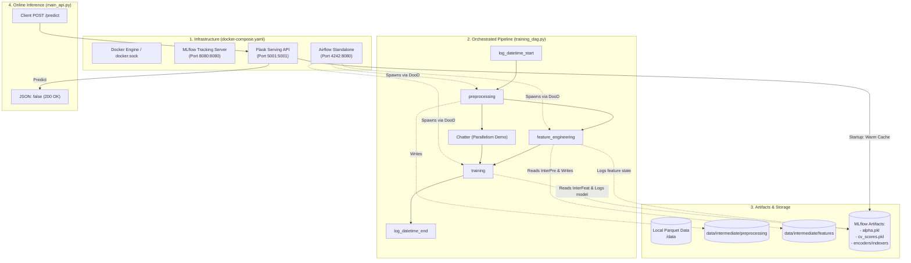

# Course Walk-Through: End-to-End ML Deployment (Week 4)

> **Instructor Guide & Live Demo Script**  
> **Course:** Machine Learning in Production (UvA) — Week 4: Deployment  
> **Repository:** [uva-mlprod-code](file:///Users/kemalty/uva-mlprod-code)  
> **Target Audience:** Graduate / Advanced ML Engineering Students  
> **Primary Goal:** Walk students through transitioning an offline ML pipeline into an orchestrated, containerized, end-to-end production deployment using Docker Compose, Apache Airflow, MLflow, and Flask.

---

## Pedagogical Overview & Flow Map

This walk-through connects the offline modeling patterns from **Week 3 (Fault Tolerance & Multi-step Pipelines)** to **Week 4 (Container Orchestration, Continuous Training, and Model Serving)**.



### Flow at a Glance
1. **Section 1: Architecture & Clean Slate** — Reset containers and introduce the multi-service topology.
2. **Section 2: Infrastructure as Code Deep Dive** — Inspect [docker-compose.yaml](file:///Users/kemalty/uva-mlprod-code/infra/docker-compose.yaml) and discuss port allocations, networking, authentication, and Docker-out-of-Docker (DooD).
3. **Section 3: Pipeline Architecture & Fault Tolerance** — Inspect [main_training.py](file:///Users/kemalty/uva-mlprod-code/src/main_training.py) and [training_dag.py](file:///Users/kemalty/uva-mlprod-code/infra/airflow/dags/training_dag.py), connecting Week 3 fault tolerance to Airflow orchestration.
4. **Section 4: Feature Store & Train/Serve Parity** — Inspect [feature_extractor.py](file:///Users/kemalty/uva-mlprod-code/src/feature_extractor.py) and explore why Spark state handling prevents train/serve skew.
5. **Section 5: Live Execution #1 — Starting Infrastructure & Running the DAG** — Spin up MLflow + Airflow and trigger the DAG live in the browser.
6. **Section 6: Live Execution #2 — Inspecting MLflow Artifacts** — Examine the trained model, CV scores, and pipeline artifacts in the MLflow UI.
7. **Section 7: Serving API Deep Dive & Cold-Start Optimization** — Inspect [main_api.py](file:///Users/kemalty/uva-mlprod-code/src/main_api.py), discuss cache warming, and spin up the serving container.
8. **Section 8: Live Execution #3 — End-to-End API Verification** — Send sample inference requests via curl/script and verify the response and server logs.
9. **Section 9: Wrap-up & Production Modernization Discussion** — Contrast local demo choices with cloud production architectures (S3, Kubernetes, Model Registry, WSGI).

---

## Section 1: Session Kick-off & Starting Fresh

### 🎯 Learning Objective
Understand the state dependencies in modern ML systems: why starting the serving application before the model registry is populated will fail, and why starting with a clean container state guarantees reproducibility.

### 🗣️ Instructor Talking Points
- Welcome the class to Week 4 (Deployment).
- Recall the progression: in Week 3, we focused on model development, cross-validation, and pipeline modularity. Today, we operationalize that code.
- In production ML, an inference service cannot start in a vacuum; it has external dependencies (model artifacts, metadata registry, feature stores).
- We first bring down all leftover containers to guarantee a deterministic demo.

### 💻 Live Commands
Run from the repository root:

```bash
docker compose -f infra/docker-compose.yaml down
```

> [!NOTE]
> If students ask about the Docker image `nova:latest`: ensure it is built prior to running services. Point to the [Makefile](file:///Users/kemalty/uva-mlprod-code/Makefile#L9-L12) and [Dockerfile](file:///Users/kemalty/uva-mlprod-code/infra/build/Dockerfile#L1-L16):
> ```bash
> make build
> # Equivalent to: docker build . -t nova -f infra/build/Dockerfile
> ```

---

## Section 2: Infrastructure as Code (`infra/docker-compose.yaml`)

### 🎯 Learning Objective
Analyze how multiple heterogenous services (experiment tracker, orchestrator, inference server) are configured, networked, and health-checked.

### 🔍 Code Walkthrough & Notes

Open [infra/docker-compose.yaml](file:///Users/kemalty/uva-mlprod-code/infra/docker-compose.yaml) and guide students line-by-line:

#### 1. Port Collision & Remapping
- **Code:** [docker-compose.yaml#L31-L32](file:///Users/kemalty/uva-mlprod-code/infra/docker-compose.yaml#L31-L32)
  ```yaml
  ports:
    - "4242:8080"  # note: We need to use a different port than 8080 as it is already assigned for mlflow.
  ```
- **Instructor Note:** MLflow runs on port `8080` internally and is mapped `8080:8080` ([docker-compose.yaml#L21-L22](file:///Users/kemalty/uva-mlprod-code/infra/docker-compose.yaml#L21-L22)). Airflow also defaults to port `8080`. To avoid host port collisions, Airflow's webserver is mapped to host port `4242`.

#### 2. Authentication: Development vs Production
- **Code:** [docker-compose.yaml#L33-L35](file:///Users/kemalty/uva-mlprod-code/infra/docker-compose.yaml#L33-L35)
  ```yaml
  environment:
    - _AIRFLOW_DB_MIGRATE=true
    - AIRFLOW__CORE__SIMPLE_AUTH_MANAGER_ALL_ADMINS=true  # note: Disabling authentication completely.
  ```
- **Instructor Note:** Airflow 3 uses a simple auth manager where `ALL_ADMINS=true` bypasses login screens for a smooth classroom demo.
- **Teaching Question for Students:** *"What are the risks of this in staging/production? How would we handle authentication in an enterprise setup?"* (Answers: OAuth 2.0 / OIDC, LDAP, AWS IAM Identity Center, Airflow RBAC).

#### 3. DAG Deployment: Local Volume Mount vs CI/CD
- **Code:** [docker-compose.yaml#L36-L37](file:///Users/kemalty/uva-mlprod-code/infra/docker-compose.yaml#L36-L37)
  ```yaml
  volumes:
    - ./airflow/dags/:/opt/airflow/dags  # note: Normally you pass DAGs to Airflow in a different way, through CI...
  ```
- **Instructor Note:** For local rapid development, mounting the host directory directly into `/opt/airflow/dags` gives instant feedback without container rebuilds. In enterprise production, DAGs are deployed via CI/CD pipelines (e.g., syncing from Git to S3 buckets, Azure Blob Storage, or GCS synced by `git-sync` sidecars).

#### 4. Docker-in-Docker / Docker-out-of-Docker (DooD)
- **Code:** [docker-compose.yaml#L38](file:///Users/kemalty/uva-mlprod-code/infra/docker-compose.yaml#L38)
  ```yaml
  - /var/run/docker.sock:/var/run/docker.sock  # note: For local deployment: linking local docker to Airflow
  ```
- **Instructor Note:** Mounting the host's Docker socket into the Airflow container allows Airflow's `DockerOperator` to instruct the *host* daemon to spin up sibling containers.
- **Security Alert:** Mention that giving a container access to `/var/run/docker.sock` grants root-equivalent privileges on the host engine. In Kubernetes production, teams use `KubernetesPodOperator` with tight RBAC instead.

#### 5. Efficient Health Checks
- **Code:** [docker-compose.yaml#L39-L41](file:///Users/kemalty/uva-mlprod-code/infra/docker-compose.yaml#L39-L41)
  ```yaml
  healthcheck:
    test: wget http://localhost:8080/api/v2/monitor/health -o /dev/null || exit 1  # note: wget downloads the file...
  ```
- **Instructor Note:** By default, `wget` writes the downloaded payload to disk. Running `-o /dev/null` discards log output and saved responses, checking only the exit code.

#### 6. macOS Port Conflict Gotcha & Startup Delays
- **Code:** [docker-compose.yaml#L10-L15](file:///Users/kemalty/uva-mlprod-code/infra/docker-compose.yaml#L10-L15)
  ```yaml
  ports:
    - "5001:5001"  # see: https://developer.apple.com/forums/thread/682332
  healthcheck:
    ...
    interval: 30s  # Cache loading is taking a long time for this app
  ```
- **Instructor Note:** On macOS Monterey and later, Apple's AirPlay Receiver listens on port `5000` by default. Binding to `5000` causes silent failures or access errors; hence port `5001` is used.
- Explain why the health check interval is set to `30s`: the application warms up MLflow artifacts and initializes a PySpark session upon startup.

---

## Section 3: Training Pipeline & Fault Tolerance

### 🎯 Learning Objective
Understand how multi-step pipeline architectures support fault tolerance, task recovery, and pipeline orchestration.

### 🔍 Code Walkthrough & Notes

Open [src/main_training.py](file:///Users/kemalty/uva-mlprod-code/src/main_training.py) and [infra/airflow/dags/training_dag.py](file:///Users/kemalty/uva-mlprod-code/infra/airflow/dags/training_dag.py):

#### 1. Decoupled Multi-Step Execution (Week 3 Recap)
- **Code:** [main_training.py#L21-L26](file:///Users/kemalty/uva-mlprod-code/src/main_training.py#L21-L26)
  ```python
  # note: Changed the main to multi-step process. See the "Fault Tolerance" and recovery at W3.
  @click.command()
  @click.option("--preprocess", is_flag=True, help="Flag argument for running Preprocessing step.")
  @click.option("--feat-eng", is_flag=True, help="Flag argument for running Feature Engineering step.")
  @click.option("--training", is_flag=True, help="Flag argument for running Training step.")
  def main(preprocess: bool, feat_eng: bool, training: bool):
  ```
- **Instructor Note:** Rather than running a monolithic script (`python train.py`), we broken the pipeline into discrete, CLI-flagged stages:
  1. `--preprocess`: Reads raw data from [PathsConfig.raw_data_path](file:///Users/kemalty/uva-mlprod-code/configs/configs.py#L6) (`data/trx/`), filters dates, and saves intermediate parquet to [PathsConfig.preprocessing_data_path](file:///Users/kemalty/uva-mlprod-code/configs/configs.py#L7) ([main_training.py#L27-L30](file:///Users/kemalty/uva-mlprod-code/src/main_training.py#L27-L30)).
  2. `--feat-eng`: Reads intermediate preprocessing parquet, fits and runs `FeatureExtractor`, logs feature transformers to MLflow, and writes features parquet to [PathsConfig.features_data_path](file:///Users/kemalty/uva-mlprod-code/configs/configs.py#L8) ([main_training.py#L32-L42](file:///Users/kemalty/uva-mlprod-code/src/main_training.py#L32-L42)).
  3. `--training`: Reads features parquet, trains `RandomForestClassifier`, calculates CV scores, logs the model and metrics to MLflow, and finishes the run ([main_training.py#L44-L60](file:///Users/kemalty/uva-mlprod-code/src/main_training.py#L44-L60)).
- **Why this matters for Fault Tolerance:** If model training fails (e.g., hyperparameter out-of-memory), we do not need to re-execute expensive raw data extraction and preprocessing. We recover directly from the intermediate feature checkpoint!

#### 2. Airflow DAG & Container Networking
- **Code:** [training_dag.py#L20-L42](file:///Users/kemalty/uva-mlprod-code/infra/airflow/dags/training_dag.py#L20-L42)
  ```python
  preprocessing_task = DockerOperator(
      docker_url="unix://var/run/docker.sock",
      command="python src/main_training.py --preprocess",
      image="nova:latest",
      network_mode="infra_default",
      task_id="preprocessing",
      mounts=[Mount(source="data", target="/nova/data")],  # note: Normally we do not do this via local files...
      dag=dag,
  )
  ```
- **Instructor Note on Storage:** [training_dag.py#L28-L30](file:///Users/kemalty/uva-mlprod-code/infra/airflow/dags/training_dag.py#L28-L30). Note how we mount local directory `data` into `/nova/data`. In production cloud pipelines, tasks read and write directly to an object store like S3 (`s3://my-bucket/...`) or GCS.
- **Instructor Note on Networking:** [training_dag.py#L38](file:///Users/kemalty/uva-mlprod-code/infra/airflow/dags/training_dag.py#L38). Notice `network_mode="infra_default"`. When `DockerOperator` launches a container on the host daemon, Docker assigns it to the default bridge network unless explicitly instructed otherwise. If `network_mode` is omitted, the task container will fail when attempting to resolve and reach `http://mlflow:8080`!

#### 3. Airflow DAG Structure & Parallelism Demo
- **Code:** [training_dag.py#L44-L46](file:///Users/kemalty/uva-mlprod-code/infra/airflow/dags/training_dag.py#L44-L46) and dependencies [training_dag.py#L61-L67](file:///Users/kemalty/uva-mlprod-code/infra/airflow/dags/training_dag.py#L61-L67)
  ```python
  completely_unnecessary_task_to_display_parallelism = BashOperator(
      task_id="Chatter", bash_command="for i in {1..10}; do date +'%Y-%m-%d %H:%M:%S'; sleep 5; done", dag=dag
  )

  (
      log_datetime_start_task
      >> preprocessing_task
      >> [feat_eng_task, completely_unnecessary_task_to_display_parallelism]
      >> model_training_task
      >> log_datetime_end_task
  )
  ```
- **Instructor Note:** Explain to students why `Chatter` exists: to visually demonstrate Airflow's ability to schedule and execute tasks in parallel (fan-out / fan-in) within the DAG graph.

---

## Section 4: Feature Store & Train/Serve Parity

### 🎯 Learning Objective
Understand how stateful transformations (imputations, scalers, encoders) introduce train/serve skew if training and inference code paths diverge, and how Spark serialization is handled.

### 🔍 Code Walkthrough & Notes

Open [src/feature_extractor.py](file:///Users/kemalty/uva-mlprod-code/src/feature_extractor.py):

#### 1. Separation of Data/State from Business Logic
- **Code:** [feature_extractor.py#L15-L29](file:///Users/kemalty/uva-mlprod-code/src/feature_extractor.py#L15-L29)
  ```python
  class _FeatureExtractorData:
      """Class for holding the data for FeatureExtractor.
      It is important to separate data from logic."""
  ```
- **Instructor Note:** Clean code principle. The extractor logic operates on data; the state (means, standard deviations, fitted indexers, and encoders) is encapsulated in a dedicated dataclass-like structure.

#### 2. The Spark Non-Pickleable Problem
- **Code:** [feature_extractor.py#L43-L55](file:///Users/kemalty/uva-mlprod-code/src/feature_extractor.py#L43-L55)
  ```python
  # Spark objects tend to be non-pickle'able due to their distributed nature. Because of that, we need to use its own write function.
  column_path_map = {"indexer": {}, "encoder": {}}
  for key, value in self._indexer_per_column.items():
      column_path_map["indexer"][key] = f"{PathsConfig.indexer_per_column_file_name_prefix}{key}"
      value.save(os.path.join(directory_path, column_path_map["indexer"][key]))
  ```
- **Instructor Note:** Standard Python `pickle` fails on PySpark models (`StringIndexerModel`, `OneHotEncoderModel`) because they wrap underlying JVM pointers and thread locks. We must persist them via PySpark's native `.save()` and load them with `.load()`.
- **Active Spark Session Requirement:** [feature_extractor.py#L91-L93](file:///Users/kemalty/uva-mlprod-code/src/feature_extractor.py#L91-L93) shows that before calling `StringIndexerModel.load()`, an active `SparkSession` must be instantiated.

#### 3. Preventing Train/Serve Skew
- **Code:** [feature_extractor.py#L223-L226](file:///Users/kemalty/uva-mlprod-code/src/feature_extractor.py#L223-L226) and [feature_extractor.py#L298-L302](file:///Users/kemalty/uva-mlprod-code/src/feature_extractor.py#L298-L302)
  ```python
  # Another example why training and inference code must be the exact same implementation:
  # https://en.wikipedia.org/wiki/Unbiased_estimation_of_standard_deviation

  # This is an example why we need the same implementation in training and inference. Check dropLast in the signature.
  ```
- **Instructor Note:** Explain train/serve skew to students:
  - If training calculates sample standard deviation ($N-1$ degrees of freedom) while inference calculates population standard deviation ($N$), predictions silently degrade.
  - If training uses One-Hot Encoding with `dropLast=True` (to avoid collinearity in regression models) and inference omits this parameter, the feature vector dimensions mismatch and inference will crash.
  - By routing both training and inference through the exact same `FeatureExtractor.get_features()` entrypoint ([feature_extractor.py#L138-L151](file:///Users/kemalty/uva-mlprod-code/src/feature_extractor.py#L138-L151)), skew is mathematically eliminated.

---

## Section 5: Live Execution #1 — Starting Infrastructure & Running Airflow DAG

### 🎯 Learning Objective
Bring up the foundational data platform services (MLflow and Airflow), observe health probe synchronization, and trigger the training DAG in Airflow.

### 🗣️ Step-by-Step Instructor Guide

#### Step 1: Start MLflow and Airflow
Run in the terminal:

```bash
docker compose -f infra/docker-compose.yaml up mlflow airflow
```

> [!TIP]
> In your terminal, you can press `d` to detach if needed. Emphasize to students: *"Notice that we do NOT start the `app` service yet. If we started `app` now, it would try to fetch model `alpha` from experiment `Alpha` in MLflow, which is completely empty, and crash!"*

#### Step 2: Observe Healthcheck Transitions
Open another terminal tab and run:

```bash
docker ps
```

- Watch the `STATUS` column transition from `(health: starting)` to `(healthy)`.
- Remind students why Airflow takes ~30 seconds to become healthy: DB migration and metadata initialization.

#### Step 3: Trigger the DAG in Airflow Web UI
1. Open browser: [`http://localhost:4242/`](http://localhost:4242/)
2. Notice: **No login screen appears** (highlight `AIRFLOW__CORE__SIMPLE_AUTH_MANAGER_ALL_ADMINS=true` from [docker-compose.yaml#L35](file:///Users/kemalty/uva-mlprod-code/infra/docker-compose.yaml#L35)).
3. Click on **Dags** in the left navigation menu.
4. Locate **`nova_training`** in the DAG list and click on it.
5. Point out the **Trigger** button on the top right.
6. Select **Trigger DAG**, ensure **Unpause DAG** is enabled, and submit.
7. Switch to the **Graph View**:
   - Point out `log_datetime_start` running first.
   - Point out `preprocessing` executing inside a Docker container.
   - Highlight the branch: observe `feature_engineering` and `Chatter` executing **concurrently**!
   - Watch `training` execute after both branch dependencies complete.
8. Wait until all task nodes turn dark green (**Success**).

---

## Section 6: Live Execution #2 — Verifying MLflow Artifacts

### 🎯 Learning Objective
Inspect the model registry and artifact repository to verify that the training pipeline properly serialized the model, validation metrics, and feature extractor state.

### 🗣️ Step-by-Step Instructor Guide

1. Open browser: [`http://localhost:8080/#/experiments`](http://localhost:8080/#/experiments)
2. In the left panel, click on experiment **`Alpha`** (defined in [configs.py#L33](file:///Users/kemalty/uva-mlprod-code/configs/configs.py#L33)).
3. Select the latest run: **`Run_234`** ([configs.py#L34](file:///Users/kemalty/uva-mlprod-code/configs/configs.py#L34)).
4. Navigate to the **Artifacts** tab and inspect the saved files:
   - `alpha.pkl`: The serialized `RandomForestClassifier` model ([model.py#L55](file:///Users/kemalty/uva-mlprod-code/src/model.py#L55)).
   - `cv_scores.pkl`: Cross-validation scores ([main_training.py#L57](file:///Users/kemalty/uva-mlprod-code/src/main_training.py#L57)).
   - `mean_amount_all_categories.pkl`, `std_amount_all_categories.pkl`: Scalar statistics for amount z-scoring.
   - `mean_amount_per_category.pkl`, `std_amount_per_category.pkl`: Per-category lookup tables.
   - `column_path_map.pkl` and directories for Spark `StringIndexer` and `OneHotEncoder`.
5. Point out to students: *"MLflow here serves as our decoupled contract. The Airflow training pipeline produced these artifacts; our serving layer will consume them without knowing how they were trained."*

---

## Section 7: Live Execution #3 — Serving API & Cold-Start Optimization

### 🎯 Learning Objective
Examine how model serving applications fetch artifacts dynamically from MLflow and why cold-start caching strategies are necessary for production SLAs.

### 🔍 Code Walkthrough & Notes

Open [src/main_api.py](file:///Users/kemalty/uva-mlprod-code/src/main_api.py):

#### 1. Pre-warming Caches & First-Request Latency Spikes
- **Code:** [main_api.py#L15-L37](file:///Users/kemalty/uva-mlprod-code/src/main_api.py#L15-L37)
  ```python
  @cache
  def get_model() -> Model:
      ...
      model.load_model_from_mlflow(run_id)
      return model

  # Doing "starting up tasks" like loading the model and feature extractor to cache before the app is started.
  # So that the first request wont have a big latency spike.
  get_model()
  get_feature_extractor_loaded()
  SparkSession.builder.master(run_config.spark_master_url).getOrCreate()
  ```
- **Instructor Note:** Without lines 35-37, the first user sending a transaction would wait 10–20 seconds while the app contacts MLflow, downloads artifacts, boots the JVM, and instantiates Spark.
- By pre-warming the `@cache` at module import time, subsequent API requests are fast.

#### 2. Endpoints: Health vs Inference
- **Code:** [main_api.py#L41-L65](file:///Users/kemalty/uva-mlprod-code/src/main_api.py#L41-L65)
  - `/health`: Liveness probe used by Docker ([docker-compose.yaml#L13](file:///Users/kemalty/uva-mlprod-code/infra/docker-compose.yaml#L13)).
  - `/predict`: Accepts JSON payload `{"amount": ..., "category": ..., "payment_type": ...}`, creates a Spark DataFrame, transforms it using the identical `FeatureExtractor`, expands nested vectors with [get_nested_column_extended](file:///Users/kemalty/uva-mlprod-code/src/data_preprocessing.py#L11), and invokes `model.predict()`.

### 💻 Live Commands
Now that MLflow has the artifacts, launch the serving app:

```bash
docker compose -f infra/docker-compose.yaml up app
```

> [!TIP]
> Keep this terminal in the foreground (do not pass `-d` or detach) so students can see Flask booting up, MLflow artifacts downloading, PySpark starting, and the server binding to `0.0.0.0:5001`.

---

## Section 8: Live Execution #4 — Testing the Deployed ML API

### 🎯 Learning Objective
Verify the end-to-end deployed pipeline by interacting with the live REST API, observing latency, and tracing the request-response lifecycle.

### 💻 Live Commands & Verification

#### 1. Verify Health Endpoint
Open a new terminal tab:

```bash
curl -i http://localhost:5001/health
```

**Expected Output:**
```http
HTTP/1.1 200 OK
Content-Type: text/html; charset=utf-8
Content-Length: 2

OK
```

#### 2. Inspect the Example Request Script
Open and review [scripts/api_request_example.sh](file:///Users/kemalty/uva-mlprod-code/scripts/api_request_example.sh):

```bash
curl \
-H "Content-Type: application/json" \
-d '{"amount":123.00, "category":"food", "payment_type": "1"}' \
 -X POST http://127.0.0.1:5001/predict
```

#### 3. Send the Prediction Request
Execute the script:

```bash
sh scripts/api_request_example.sh
```

**Expected Response in Terminal:**
```json
false
```

#### 4. Trace Server Logs
Switch back to the terminal tab running `docker compose up app` and observe:

```log
127.0.0.1 - - [14/Oct/2026 23:15:00] "POST /predict HTTP/1.1" 200 -
```

🎉 **Milestone:** You have successfully built, trained, orchestrated, tracked, deployed, and served an End-to-End ML application!

---

## Section 9: Instructor Wrap-Up & Discussion Guide

Conclude the lecture by summarizing key concepts and prompting student discussion on how this local deployment evolves into enterprise-scale cloud architecture:

| Architecture Dimension | Local Teaching Setup (Current Codebase) | Cloud Production Architecture |
| :--- | :--- | :--- |
| **Data Storage** | Local directory mounted to container ([training_dag.py#L28](file:///Users/kemalty/uva-mlprod-code/infra/airflow/dags/training_dag.py#L28)) | Cloud Object Stores (AWS S3, Google Cloud Storage, Azure Blob Storage) |
| **Container Orchestration** | Docker-out-of-Docker via `/var/run/docker.sock` ([docker-compose.yaml#L38](file:///Users/kemalty/uva-mlprod-code/infra/docker-compose.yaml#L38)) | Kubernetes (`KubernetesPodOperator`), AWS ECS, or managed Airflow (Astronomer / MWAA / Cloud Composer) |
| **Authentication & IAM** | Disabled (`ALL_ADMINS=true` [docker-compose.yaml#L35](file:///Users/kemalty/uva-mlprod-code/infra/docker-compose.yaml#L35)) | OAuth 2.0 / OIDC, Keycloak, AWS IAM, Role-Based Access Control (RBAC) |
| **Model Registry** | MLflow Run Artifacts (`Run_234`) | MLflow Model Registry with Model Aliases (`@champion`, `@challenger`), governance, and staging gates |
| **Serving Layer** | Flask dev server (`flask run`) | Production WSGI/ASGI servers (Gunicorn, Uvicorn, Triton, TorchServe) with Horizontal Pod Autoscaling (HPA) |
| **Feature Store** | Custom `FeatureExtractor` persisted to MLflow | Feast, Hopsworks, or Databricks Feature Store for online (Redis) / offline (Parquet) parity |

### 💬 Discussion Prompts to Ask the Class
1. *"What happens if a new transaction arrives with a category never seen during training?"*  
   (Guide them to look at `_get_z_score_per_category` in [feature_extractor.py#L227-L235](file:///Users/kemalty/uva-mlprod-code/src/feature_extractor.py#L227-L235): it raises a `ValueError`. Ask how they would handle unseen categories in production — e.g. unknown category fallback/imputation).
2. *"Why is relying on `latest_run` in `get_latest_run_id()` risky for production?"*  
   (Guide them to [mlflow_utils.py#L36](file:///Users/kemalty/uva-mlprod-code/src/mlflow_utils.py#L36): an automated retrain might push a faulty run. Discuss why Model Registry tags/aliases like `@production` or `@champion` are used instead of blindly loading the latest run).
3. *"Why is warming the cache in `src/main_api.py` essential for Kubernetes readiness probes?"*  
   (If readiness probes check `/health` before the model is loaded, the container might receive traffic before it can actually handle requests, or fail health checks if initialization takes longer than probe timeouts).
